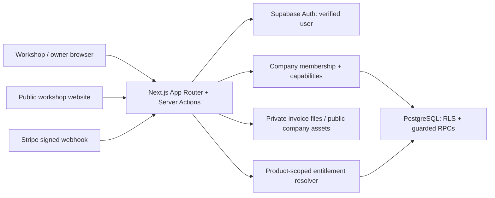

# Architecture

`lib/company.ts` verifies the Supabase user and active company membership. Role/capability checks are application guards; database RLS and RPC authorization remain necessary. Companies share a platform, not copied databases per customer.

Multi-step stock, invoice and appointment mutations use database functions. Issued invoice identity/facts are frozen and document storage has hashes; this does not establish regulatory certification. Public appointment submission is a request, not an automatically confirmed appointment.

Stripe Customer/Checkout/Portal operations are server-side. A success redirect is not entitlement authority; the signed webhook calls a service-role-only database function with event-ID deduplication. The entitlement resolver chooses an active product-specific grant, Stripe entitlement or eligible trial. BusinessSite demo/publishing and Pitlane trial are separate states. The lifecycle is not verified as live billing.

Six message catalogs are checked for key parity. The website engine selects category/subcategory presets and validates its generation contract. Public content is resolved at `/b/[slug]`; custom-domain resolution is a separate integration that requires its own deployment verification.
